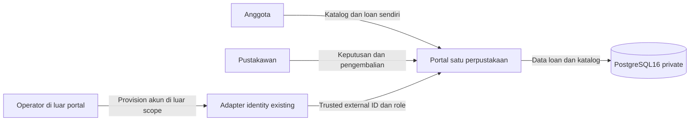
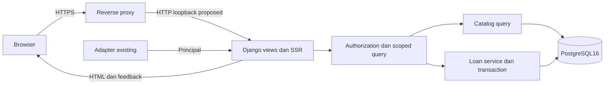
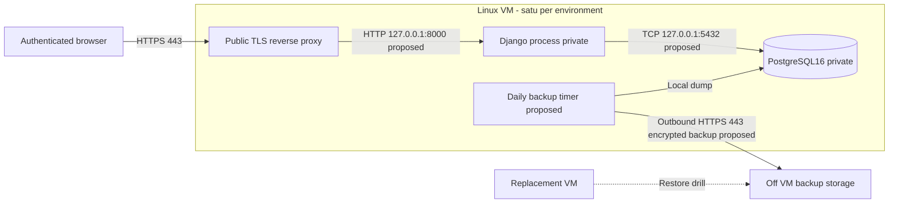
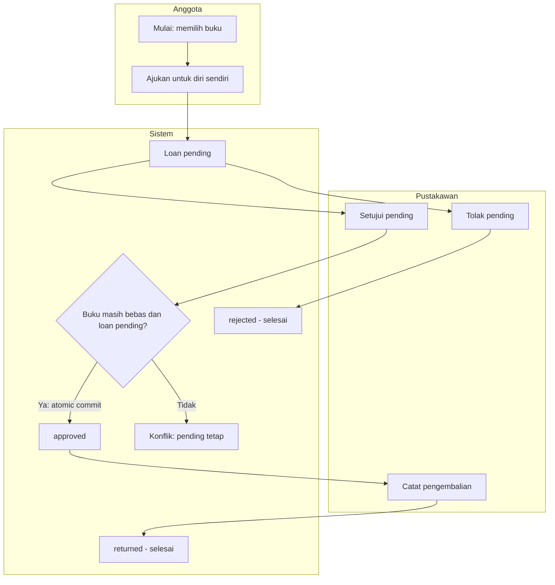
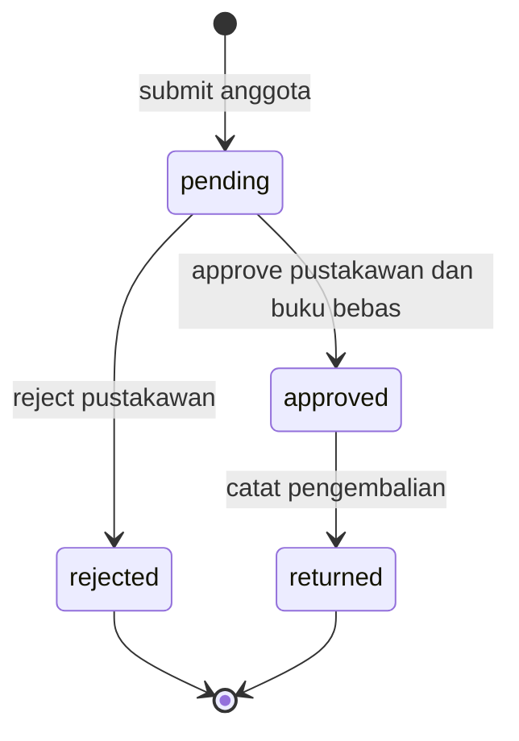
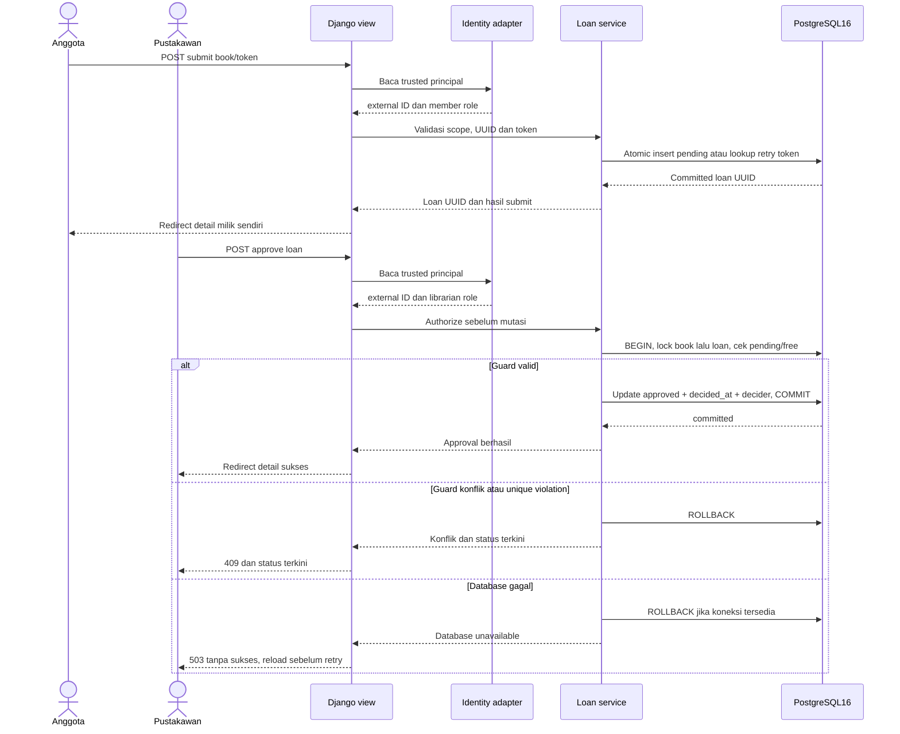
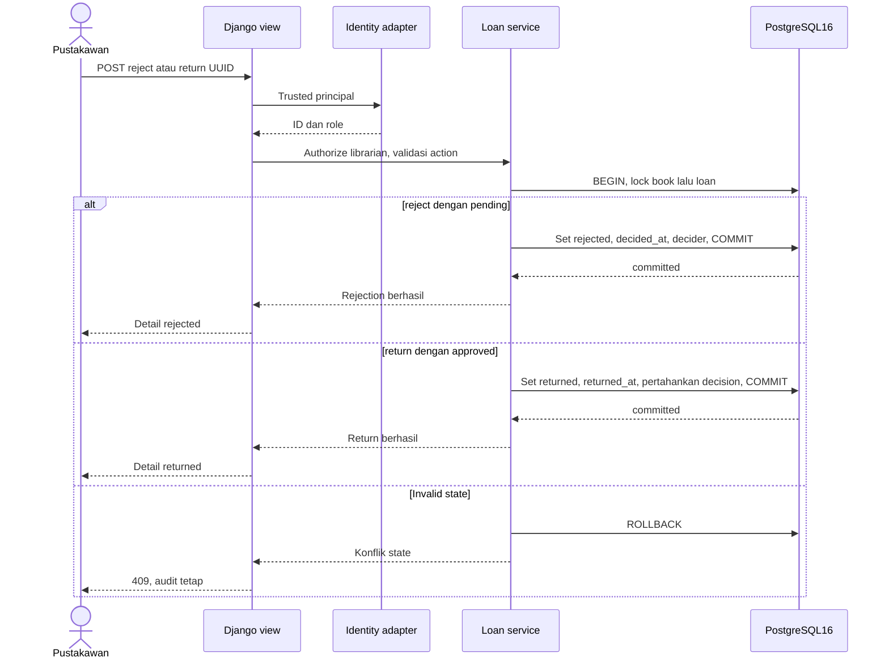
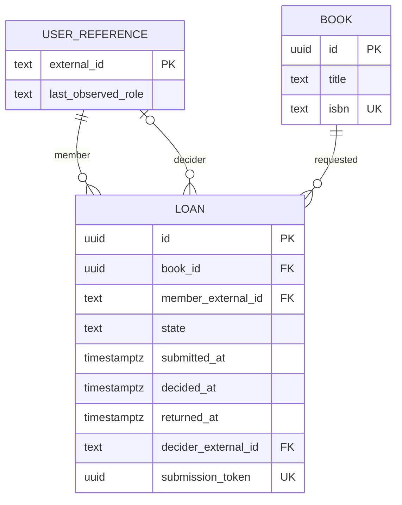
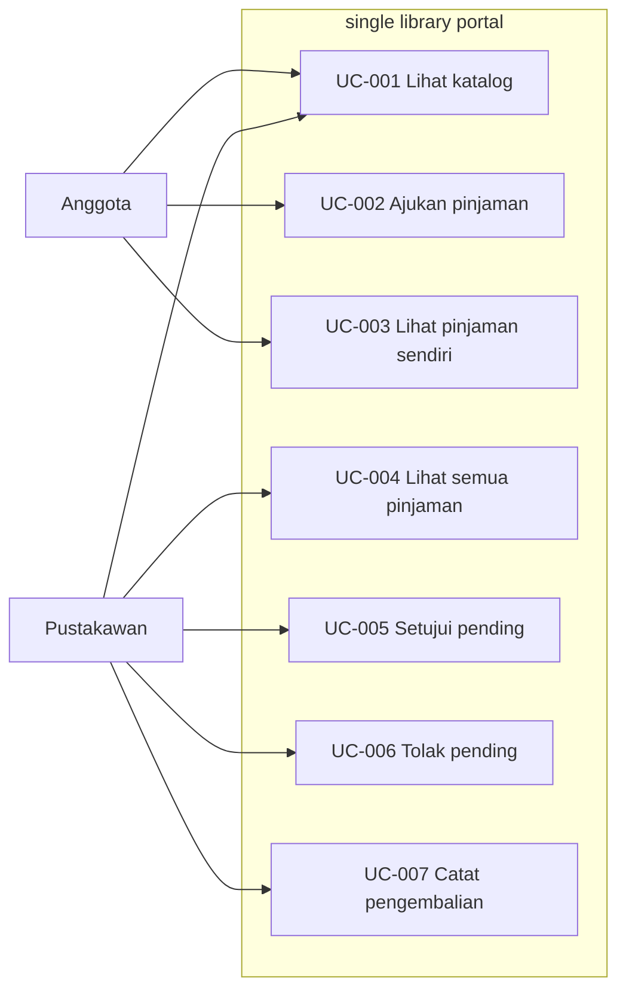
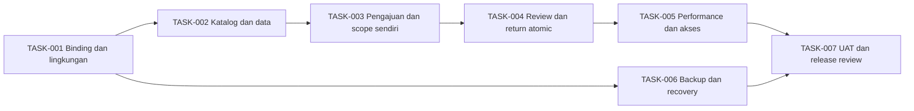

# Arsitektur proposed
0.1 MVP/draft. Stack dan exposure confirmed SRC-001 S6; pembagian modul, ports, sizing, backup dan routes proposed.

## DIA-001: Konteks
MVP, proposed/draft. Links: PRD-001–009; IF-001. Editable source: [diagrams/context.mmd](diagrams/context.mmd). Legend: solid = interaction/dependency; dashed = recovery relation; shapes are logical nodes unless topology VM boundary specifies deployment.

## DIA-002: Komponen
MVP, proposed/draft. Links: FR-001–007; BR-001–003. Editable source: [diagrams/components.mmd](diagrams/components.mmd). Legend: solid = interaction/dependency; dashed = recovery relation; shapes are logical nodes unless topology VM boundary specifies deployment.

## DIA-003: Topology staging dan produksi
MVP, proposed/draft. Links: NFR-002, NFR-003. Editable source: [diagrams/topology.mmd](diagrams/topology.mmd). Legend: solid = interaction/dependency; dashed = recovery relation; shapes are logical nodes unless topology VM boundary specifies deployment.

## DIA-004: Workflow bisnis WF-001
MVP, proposed/draft. Links: FR-002, FR-005–007; BR-001/002. Editable source: [diagrams/business.mmd](diagrams/business.mmd). Legend: solid = interaction/dependency; dashed = recovery relation; shapes are logical nodes unless topology VM boundary specifies deployment.

## DIA-005: State loan
MVP, proposed/draft. Links: BR-001; FR-005–007. Editable source: [diagrams/states.mmd](diagrams/states.mmd). Legend: solid = interaction/dependency; dashed = recovery relation; shapes are logical nodes unless topology VM boundary specifies deployment.

## DIA-006: System sequence submit dan approval
MVP, proposed/draft. Links: FR-002/005; BR-002. Editable source: [diagrams/sequence.mmd](diagrams/sequence.mmd). Legend: solid = interaction/dependency; dashed = recovery relation; shapes are logical nodes unless topology VM boundary specifies deployment.

## DIA-007: System sequence reject dan return
MVP, proposed/draft. Links: FR-006/007; BR-001/003. Editable source: [diagrams/return.mmd](diagrams/return.mmd). Legend: solid = interaction/dependency; dashed = recovery relation; shapes are logical nodes unless topology VM boundary specifies deployment.

## DIA-008: ERD proposed
MVP, proposed/draft. Links: DATA-001–003; BR-002/003. Editable source: [diagrams/erd.mmd](diagrams/erd.mmd). Legend: solid = interaction/dependency; dashed = recovery relation; shapes are logical nodes unless topology VM boundary specifies deployment.

## DIA-009: Use-case relationship map, bukan UML
MVP, proposed/draft. Links: UC-001–007. Editable source: [diagrams/usecases.mmd](diagrams/usecases.mmd). Legend: solid = interaction/dependency; dashed = recovery relation; shapes are logical nodes unless topology VM boundary specifies deployment.

## DIA-010: Dependensi task relatif
MVP, proposed/draft. Links: TASK-001–007. Editable source: [diagrams/dependencies.mmd](diagrams/dependencies.mmd). Legend: solid = interaction/dependency; dashed = recovery relation; shapes are logical nodes unless topology VM boundary specifies deployment.

## Tanggung jawab dan failure
Browser menampilkan HTML dan feedback; tidak menentukan ownership. Django view menjalankan interface/CSRF; authorization memvalidasi role principal dan scopes reads; catalog hanya read book; loan service memiliki transisi dan audit transaction. PostgreSQL menyimpan user references, books, loans dan constraints. Adapter owns identity/session; kegagalan atau principal tidak trusted menyebabkan denial sesuai contract, bukan default role. DB failure membatalkan mutasi, menampilkan unavailable. Tidak ada worker/queue/cache lintas proses yang dibutuhkan.

## Topology table
| Node | Environment | Purpose/exposure | Dependency/protocol | Persistence | Link |
|---|---|---|---|---|---|
| TLS proxy | prod/staging | public ingress | client HTTPS443; app loopback HTTP8000 proposed | TLS cert/config | NFR-003 |
| Django SSR | prod/staging | private process | adapter binding existing; DB loopback5432 | no durable app files | FR-001–007 |
| PostgreSQL16 | prod/staging | private local DB | only app/backup local | all domain data | DATA-001–003 |
| Backup timer | prod/staging | private scheduled operation | local dump, outbound HTTPS443 proposed | encrypted off-VM object | NFR-002 |
| Replacement VM | recovery drill | same topology | restore off-VM backup | restored database | NFR-002 |

Dev uses local isolated DB/synthetic fixtures, TLS optional local; staging matches prod topology and initial proposed size (2 vCPU, 4GB RAM, 40GB durable disk) for meaningful performance tests. Proposed single VM has no failover; RTO relies replacement provisioning. Never label sizing as measured sufficient. Secrets via restricted environment file owned by runtime identity; no secret values in docs/backups/logs; least privilege app database role proposed. Proxy only publicly listens 443; administrative access policy is environment setup, not portal role. Existing adapter network requirements must be inspected, not invented.

## Decision records
| ADR | Context and alternatives | Proposal/rationale | Tradeoff | Links/status |
|---|---|---|---|---|
| ADR-001 | One VM constraint; Unix socket versus loopback HTTP/TCP | loopback8000/5432 simplifies repeatable staging setup | secure via bind/firewall; no VM redundancy | NFR-003, DIA-002/003; proposed/draft |
| ADR-002 | Concurrent approved per book; app-only checks versus DB unique + locking | book-row lock plus partial unique index and state guards | serialization per book; race tests required; no global lock | BR-001/002, DIA-006; proposed/draft |
| ADR-003 | Daily backup/RPO24h/RTO8h; local-only vs off-VM | encrypted daily logical dump to independent storage; retain 7 daily copies proposed; alert at age>24h | interval plus missed run can violate RPO; dump restore must be drilled; storage/provider not selected | NFR-002; proposed/draft |
| ADR-004 | Retry submit may duplicate intent | unique form submission token stored in loan without time-based expiry; authentication/authorization checked per replay | extra technical field retained with loan; matching old token retrieves same loan, mismatched principal/book rejected; new token still permits additional pending | FR-002; proposed/draft |

Operational diagnostics proposed: request ID, operation, status, duration, exception class; no principal/session secrets. Metrics operational only, no dashboard feature. Catalog request timer supplies NFR-001 samples. Rollout and abort policy in TASK-007; no deploy performed. No unresolved question required for delegated technical proposals; actual adapter wiring and backup storage are implementation prerequisites.

## DIA-011: UML use-case diagram
MVP proposed/draft. Links UC-001–007, PERM-001–009. Editable UML source: [diagrams/usecases.puml](diagrams/usecases.puml). Actor associations enumerate allowed actions; librarian catalog grant remains proposed. Portal rectangle defines boundary. Include/extend unnecessary for independent goals. DIA-009 remains supplemental preview only. PlantUML syntax/render/visual export have not been verified; Mermaid validation cannot validate UML.
